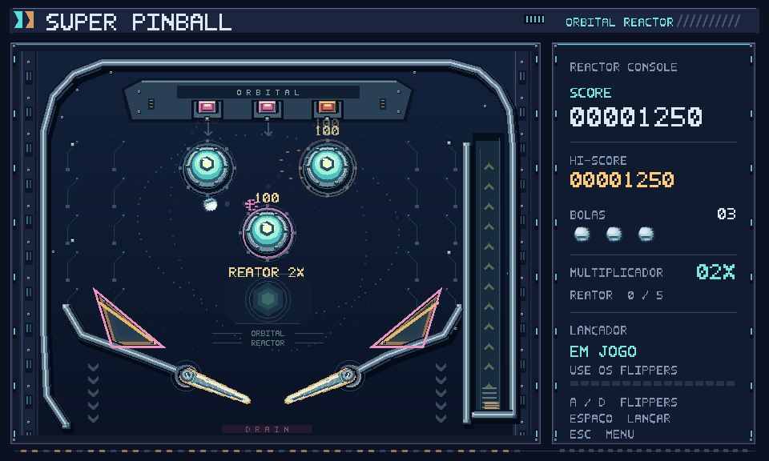
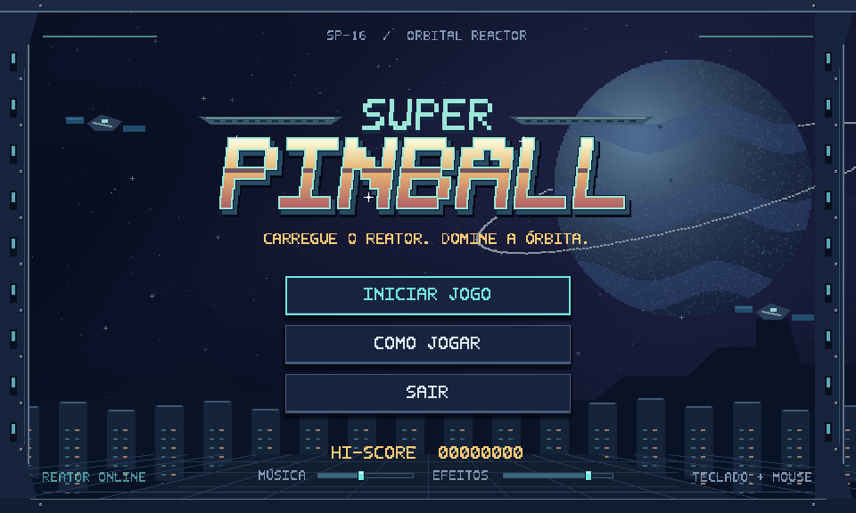

# Super Pinball — Orbital Reactor

## Implementação

A branch `codex/pinball` parte do commit da versão 16-bit e apresenta uma mesa completa no mesmo gabinete 960 × 576, com o campo 640 × 480 em (24, 64). Menu, fonte, Game Over, sistema de áudio e controles de volume foram reaproveitados. A identidade e o manual agora descrevem pinball.

A jogabilidade é própria: uma esfera `RigidBody2D`, gravidade, flippers articulados, canal com lançador variável, três bumpers, três alvos, duas borrachas triangulares, saídas laterais e drenagem inferior. Cada partida usa três bolas. Não há geração de tiros ou blocos na mesa.

## Física e controle

- A esfera circular tem raio 10, gravidade de 0,72 da gravidade 2D padrão e detecção contínua por forma.
- A simulação usa 120 passos por segundo. `_integrate_forces` limita a velocidade a 1.100 px/s sem substituir a gravidade do motor.
- Flippers são corpos animáveis com cápsulas de raio 9 e eixo de 80 px. Pivôs (208, 405) e (412, 405), repouso de ±22° e golpe até ∓28°.
- A rotação física afeta a esfera. Um impulso por golpe completa a resposta apenas perto da palheta; manter a tecla não acumula impulsos contínuos.
- Bumpers usam um corpo circular e um sensor próximo à borda visível. O intervalo de 140 ms protege o mesmo contato de pontuar duas vezes.
- A força do lançador cresce ao segurar Espaço, limitada a 100%. Um toque breve também gera força suficiente para sair do canal.
- O arco superior redireciona a esfera pelas próprias colisões; não há teleporte do lançador para o campo.
- Colisões ficam em camadas próprias: esfera 128, mesa 256, flippers 512 e sensores 1.024.

## Partida e pontuação

`GameManager` continua como fonte única dos estados `MAIN_MENU`, `READY`, `PLAYING` e `GAME_OVER`. O lançador só funciona em READY sem bloqueio. Drenagem muda o estado imediatamente e rejeita uma segunda perda da mesma bola. A reposição usa um Timer de 1,2 segundo e a mesma instância física.

Cada bumper vale 100, alvo 250 e borracha triangular 50 pontos base. Acender a bancada de três alvos dá 1.000 pontos de bônus, depois apaga as luzes em 1,4 segundo. Cinco ativações do reator dão 500 pontos de bônus e aumentam o multiplicador até 5x. O valor atual multiplica eventos e bônus.

O recorde usa `user://pinball_records.cfg`. Pontuação, multiplicador e alvos parcialmente acesos permanecem entre bolas. Nova partida restaura todos os dados, preservando o recorde. As APIs antigas de blocos permanecem disponíveis para carregar os scripts de referência do Arkanoid; a mesa usa `add_score` e `hit_reactor`.

A música não reinicia ao repor a esfera. Bumpers, flippers, alvos, lançamento e bônus reaproveitam efeitos do gerenciador existente, incluindo as escolhas de áudio feitas pelo usuário.

## Novos arquivos

- `Scenes/Pinball/pinball.tscn`, `ball.tscn`, `flipper.tscn`, `bumper.tscn`, `target.tscn`.
- `Scripts/Pinball/table.gd`, `table_layout.gd`, `ball.gd`, `flipper.gd`, `bumper.gd`, `target.gd`, `slingshot.gd`, `score_popup.gd`.
- `Assets/Pinball/`: playfield, logo, esfera, bumper, flipper, alvo e ícone de bola, com documentação e metadados de importação.
- `Tools/generate_pinball_art.py`.
- `Tests/pinball_test.gd`.
- Este relatório e capturas de execução em `Docs/preview_pinball*.png`.

## Arquivos adaptados

- `project.godot`: título, frequência da física e camadas da mesa.
- `Scripts/game_manager.gd`: novo destino de partida, recorde separado, reator, multiplicador e força do lançador.
- `Scripts/UI/main_menu.gd`, `hud.gd`, `game_over.gd`: identidade, controles e indicadores próprios de pinball.
- `README.md`: execução, regras e estrutura desta branch.

Os arquivos de áudio e os scripts antigos de Arkanoid foram preservados.

## Validação

Executado em **7 de novembro de 2026**, no Godot **4.7.2 Mono**.

- `Tests/pinball_test.gd`: **48 verificações, 0 falhas**, saída 0.
- Inclui entrada real de mouse/teclado no menu, carga e liberação do lançador, saída pelo arco, gravidade, rebote no trilho, contato de bumper, dois flippers devolvendo a esfera para cima, bancada, multiplicador, recorde, drenagem física, proteção contra perda duplicada, reposição, Game Over, reinício e retorno ao menu.
- `Tests/quit_test.gd`: clique real em SAIR encerrou o aplicativo, saída 0.
- Logs finais com `--verbose`: sem erros de scripts, recursos ausentes, vazamentos de objetos, recursos ou RIDs.
- Execução nativa OpenGL: menu, manual, mesa pronta, mesa em jogo e Game Over renderizados e inspecionados.
- Gerador de arte executado novamente: os hashes dos sete PNGs novos permaneceram idênticos e os PNGs anteriores não foram modificados.
- `git diff --check`: sem problemas de whitespace.

Os recordes e preferências usados pelos testes ficaram em arquivos temporários separados. A execução headless em ambiente restrito emite uma mensagem de certificados do macOS; ela não impediu os testes. A execução gráfica nativa terminou sem mensagens de erro.

A implementação e os testes ficaram exclusivamente em `codex/pinball`. `develop` e `codex/redesign-16bit` permanecem nos commits anteriores, sem merge do experimento.

## Escopo desta versão

Uma mesa original, três bolas, bancada de bônus, reator e multiplicador. A geometria foi feita para uma composição horizontal de gabinete; futuras mesas podem explorar outros percursos e proporções. O código contém comentários curtos em português nos pontos de física e coordenação.

## Capturas nativas

