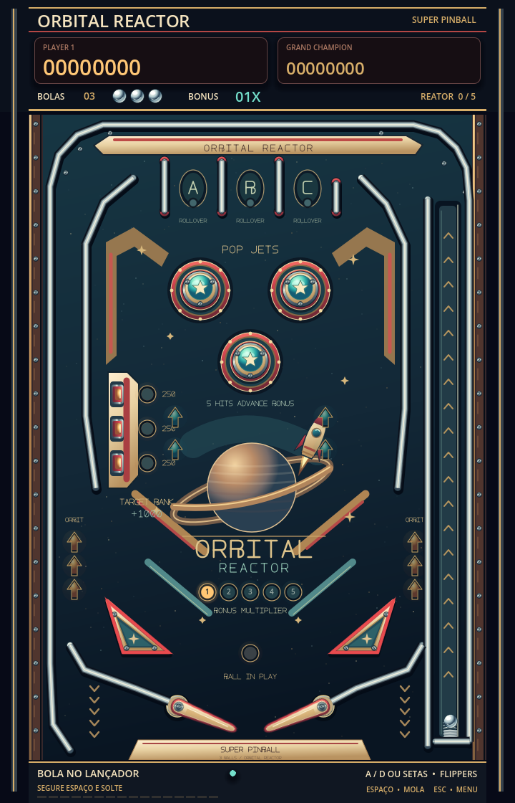
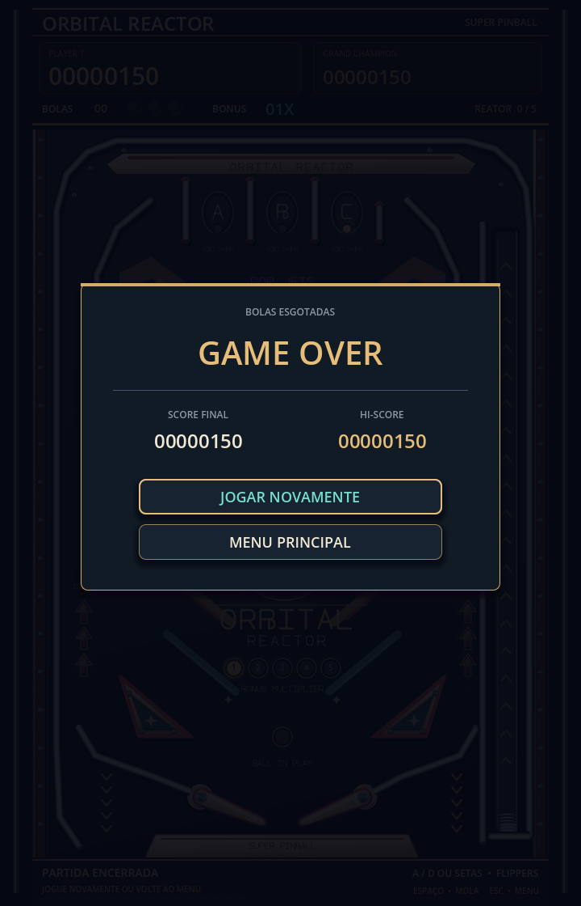

# Orbital Reactor — mesa vertical

## Composição

A branch `codex/pinball` usa viewport de 720 × 1120 e janela inicial de 540 × 840. O playfield de 640 × 900 começa em (40, 160). O placar ocupa o backbox superior; o avental inferior mostra controles e carga da mola. Menu, manual e Game Over seguem a mesma orientação.

A arte vetorial original combina Saturno e um foguete, plásticos marfim, borrachas vermelhas, cromados e insertos luminosos. A fonte da interface é a fonte padrão suave do Godot. As lâmpadas A/B/C, de multiplicador e de bola em jogo acompanham os dados reais da partida.

## Referências pesquisadas

- [Firepower — folheto original da Williams, 1980](https://flyers.arcade-museum.com/pinballs/show/6886): composição espacial, borrachas e leitura de uma mesa física.
- [Eight Ball Deluxe — instruções da Bally](https://www.pinballrebel.com/game/pins/instruction/Eight_Ball_Deluxe.pdf): pistas com letras, bancadas, bônus e três bolas.
- [Eight Ball Deluxe — fotografia do playfield](https://www.coinopking.co.uk/pinball-machines/p/bally-eightball-deluxe): distribuição vertical, contraste dos plásticos e insertos de bônus.

As referências orientam o desenho; a ilustração, o nome e os recursos gráficos desta mesa são originais. O jogo não implementa rampas elevadas ou multiball.

## Física

A esfera usa `RigidBody2D`, raio 10, gravidade de 0,72 da gravidade padrão, detecção contínua por forma e limite de 1.600 px/s. A simulação roda a 120 passos por segundo. Flippers em (208, 825) e (412, 825) articulam cápsulas de eixo 80 e raio 9, com repouso ±22° e golpe ∓28°. O impulso por golpe foi ajustado à altura da mesa e não se repete enquanto a tecla permanece pressionada.

`table_layout.gd` centraliza os contornos, guias, divisórias superiores, posições das pistas e slingshots. As cápsulas dos trilhos são divididas em trechos de até 120 px: cápsulas muito longas produziam contatos falsos do CCD no canal do lançador. A segmentação preserva o contorno e o raio de 4 px.

A divisória superior direita começa em y=95, deixando o disparo sair do arco e descer pela pista C. O movimento depende da física, sem teleporte para o centro da mesa.

A falha anterior dos canais inferiores vinha dos triângulos atravessando as guias. As borrachas ficam acima das guias e oferecem 36,9 px livres à esquerda e 32,8 px à direita para a bola de diâmetro 20 px. Os testes medem a folga e percorrem cada passagem com três entradas físicas distintas.

## Mola e retorno ao canal

`table.can_launch()` aceita o estado READY desbloqueado ou uma bola em PLAYING fisicamente na base do canal (x entre 572 e 604, y entre 800 e 865). Espaço começa a carregar inclusive se a tecla já estiver pressionada quando a bola chegar. Soltar aplica a velocidade de lançamento à mesma esfera, mantendo a partida em PLAYING.

A carga vai até 100%; o impulso vertical varia de 1.270 a 1.540 px/s. A base usa um corpo com material absorvente próprio para a bola repousar em vez de quicar indefinidamente. Pressionar Espaço no campo não desloca a bola para o lançador. A reposição após drenagem bloqueia o lançamento por 1,2 segundo.

## Regras

Três bolas por partida. Bumpers valem 100, pistas superiores 150, alvos 250 e slingshots 50 pontos base. Completar A/B/C dá mais 750 e uma carga do reator; completar os alvos dá mais 1.000. Cada bancada completa apaga suas luzes após 1,4 segundo. Cinco cargas do reator dão 500 pontos e elevam o multiplicador, limitado a 5x.

A drenagem muda o estado imediatamente e evita perdas duplicadas. A reposição reutiliza a esfera e preserva pontos e progresso. Game Over interrompe os temporizadores, apresenta o resultado e permite reiniciar ou voltar ao menu.

O recorde usa `user://pinball_records.cfg`. O gerenciador de áudio e as músicas e efeitos escolhidos pelo usuário foram preservados.

## Recursos e validação

Os oito SVGs são gerados por `Tools/generate_pinball_art.py`, usando apenas Python padrão. `Assets/Pinball/README.md` documenta tamanhos e posições. Os PNGs anteriores ficam como histórico e não são usados pela nova mesa.

As suítes `pinball_test.gd`, `pinball_channels_test.gd` e `pinball_launcher_test.gd` cobrem controles reais, física, pontos, bancadas, drenagem, persistência, retorno ao canal e relançamentos. `quit_test.gd` verifica o clique em SAIR. Arquivos temporários isolam recordes e preferências usados nos testes.

## Resultado da validação

Validado em 8 de novembro de 2026 no Godot 4.7.2 Mono:

- Integração principal: **54 verificações, 0 falhas**.
- Lançador e retornos ao canal: **21 verificações, 0 falhas**.
- Canais inferiores: **8 verificações, 0 falhas**.
- Botão SAIR acionado por clique real: saída 0.
- Total: **83 verificações aprovadas**, além do teste de encerramento.
- Execução nativa OpenGL: menu, manual, mesa pronta, mesa em jogo e Game Over renderizados e inspecionados.
- Oito SVGs validados e geração determinística conferida.
- Sem erros de scripts ou recursos ausentes nas execuções do jogo. Os testes headless no ambiente restrito registram apenas a mensagem de certificados do macOS.
- `git diff --check` sem problemas.

As alterações permanecem na branch `codex/pinball`.

## Capturas nativas

