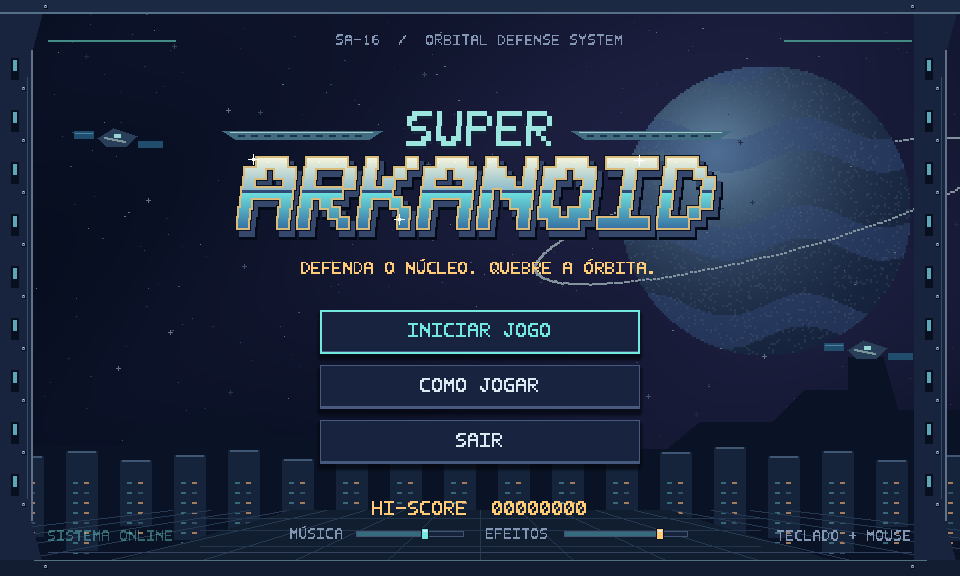
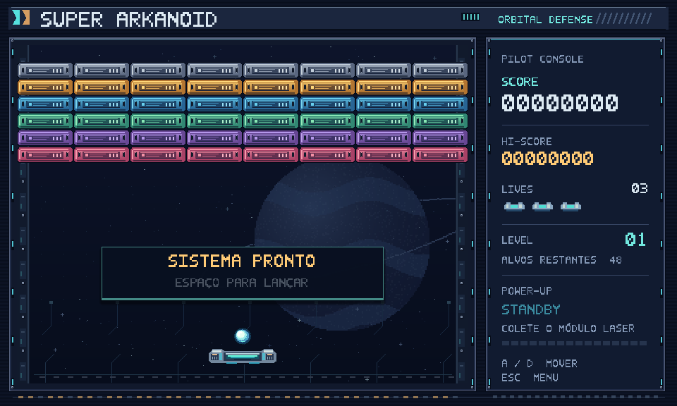

# Redesign 16-bit — implementação

## Identidade e composição

Identidade original **Orbital Defense / SA-16**: metal azul, ciano, âmbar e detalhes magenta, planeta com anéis, estação espacial, gabinete com parafusos e trilhos iluminados. Os 16 PNGs e a fonte bitmap com acentos foram produzidos por código local, sem serviços externos ou dependências comerciais. O script `Tools/generate_art.py` reproduz os arquivos.

A apresentação passa a 960 × 576. A arena continua com 640 × 480: a cena inteira recebe uma translação de (24, 64), sem escala física. O HUD ocupa outro painel, fora das colisões. Stretch `viewport`, proporção preservada e filtragem nearest mantêm pixels definidos. O renderizador Compatibility é suficiente para a arte 2D e dispensa efeitos pesados.

## Cenas e arquivos novos

| Arquivo / diretório | Responsabilidade |
| --- | --- |
| `Scenes/main.tscn` | Composição da arena e HUD |
| `Scenes/UI/main_menu.tscn` | Tela inicial |
| `Scenes/UI/hud.tscn` | Console lateral e aviso READY |
| `Scenes/UI/game_over.tscn` | Resumo final e navegação |
| `Scripts/level.gd` | Reposição de atores, limpeza, repetição de setores |
| `Scripts/block.gd` | Destruição idempotente e 100 pontos por bloco |
| `Scripts/Effects/arcade_burst.gd` | Fragmentos de impacto e coleta |
| `Scripts/UI/arcade_ui.gd` | Componentes e tema de interface |
| `Scripts/UI/main_menu.gd` | Menu, manual, teclado/mouse e entrada animada |
| `Scripts/UI/hud.gd` | Campos atualizados por sinais |
| `Scripts/UI/game_over.gd` | Pontuação final, recorde e animação |
| `Assets/16bit/` | 16 PNGs, fonte `.fnt`, documentação e metadados Godot |
| `Tools/generate_art.py` | Gerador de arte sem dependências |
| `Tests/smoke_test.gd` | Regressão de integração com 59 verificações |
| `Tests/quit_test.gd` | Encerramento por clique real no botão SAIR |

## Arquivos existentes modificados

- `project.godot`: menu inicial, autoload por caminho, apresentação e filtragem.
- `Scenes/level_1.tscn`: novos sprites, controlador e correção do alinhamento amarelo.
- `Scenes/ball.tscn`, `player.tscn`, `environment.tscn`, `item_power_up.tscn`, `bullet.tscn`: recursos gráficos originais.
- `Scenes/block.tscn`: script compartilhado de destruição.
- `Scripts/game_manager.gd`: estado central e persistência.
- `Scripts/ball.gd`: lançamento, impacto, rastro, blocos e integração com o estado.
- `Scripts/player.gd`: movimento e disparos condicionados ao estado, limpeza e propulsores visuais.
- `Scripts/environment.gd`: DeathZone com proteção de perda duplicada e reposição via TimerReset.
- `Scripts/item_power_up.gd`: coleta protegida e efeito visual.
- `Scripts/bullet.gd`: destruição compartilhada, limpeza e limite de tela.
- `README.md`: execução, controles e regras.

## Estado, vidas e pontuação

`GameManager.State` é a fonte de verdade: `MAIN_MENU`, `READY`, `PLAYING`, `GAME_OVER`. A propriedade `started` é somente uma leitura derivada de `PLAYING`, preservando compatibilidade sem manter dois controles concorrentes.

O HUD acompanha sinais de pontuação, recorde, vidas, fase, blocos e laser. Cada bloco tem uma flag de destruição que impede dois acertos de pontuarem o mesmo objeto. O recorde usa `ConfigFile` em `user://records.cfg` e é salvo quando aumenta e no Game Over.

A DeathZone muda o estado imediatamente e desconta uma única vida. Durante 2 segundos, `ready_locked` bloqueia um novo lançamento. O TimerReset solicita a reposição da bola e plataforma, mantendo a mesma cena, os blocos e o placar. A última vida abre o Game Over e encerra temporizadores e efeitos. Jogar novamente restaura todos os estados da partida; o recorde permanece.

Ao destruir a formação, um intervalo de 1,3 segundo prepara o próximo setor. A mesma formação de 48 blocos é reconstruída, sem mudar velocidades ou acrescentar dificuldade. A fase aumenta e o jogador lança novamente com Espaço.

## Mecânicas preservadas

- Bola: velocidade vertical −250 e escolha horizontal entre −200, −250, 250 e 300.
- Plataforma e projéteis: velocidade 400.
- Item: queda 80, rotação 60 graus/s, chance 20% e cooldown 15 s.
- Laser: 16 tiros em 8 duplas, intervalo 0,2 s e offsets originais (−40, −5) e (+40, −40).
- Formas, tamanhos, camadas e máscaras de colisão mantidos.

Uma correção de posicionamento foi necessária: no original, a arte amarela estava 24 px acima de sua colisão, que se sobrepunha à fileira azul. O grupo amarelo foi deslocado 24 px para cima e o offset de seus sprites foi removido. A posição visual original foi preservada, alinhando a colisão. A fileira cinza, antes invisível com colisões ativas, agora é visível.

`level_2.tscn` continua sendo o exercício anterior e não integra a navegação do laboratório. A execução principal usa `Scenes/main.tscn`; os setores repetem a formação de `level_1.tscn`.

## Validação

Executado em **7 de novembro de 2026**, com **Godot 4.7.2 Mono** instalado no macOS.

- `Tests/smoke_test.gd`: **59 verificações, 0 falhas**, saída 0.
- `Tests/quit_test.gd`: clique de mouse em SAIR encerrou o aplicativo, saída 0.
- Navegação real da GUI: mouse em COMO JOGAR e VOLTAR; Enter em INICIAR JOGO.
- Colisões físicas reais: bola destrói bloco, rebate e pontua; projétil destrói bloco, pontua e desaparece; item coleta por colisão; bola cruza a DeathZone.
- Cobertura: HUD e sinais, 100 pontos por bloco sem duplicação, arquivo de recorde salvo e recarregado, cooldown, exatamente 16 tiros e seus offsets, três vidas, reposição, preservação de placar/blocos, Game Over, nova partida, retorno ao menu e segundo setor.
- Encerramento com `--verbose`: sem avisos de nós órfãos, vazamentos de RIDs ou recursos ainda em uso.
- Execução nativa com OpenGL e inspeção visual de menu, manual, arena, reposição e Game Over. As capturas em `preview_menu.png` e `preview_arena.png` mostram a interface renderizada pelo Godot.
- Gerador de arte executado novamente: os hashes dos 16 PNGs e da fonte permaneceram idênticos.
- `git diff --check`: sem problemas de whitespace.

Os testes usam um arquivo temporário de recorde, separado do recorde do jogador. O Godot em ambiente restrito emitiu uma mensagem de acesso aos certificados do macOS na inicialização; ela não impediu a execução. A importação pelo editor Mono também encontrou restrições de integração .NET/configurações do editor, sem falhas de scripts ou recursos do jogo.

## Música e efeitos — atualização

Foram incluídas duas músicas originais em loop, dez efeitos e controles independentes de música e efeitos no rodapé do menu. A síntese local usa apenas Python padrão. A música da partida continua nas reposições e trocas de setor; o Game Over interrompe a faixa e toca sua vinheta. Os volumes persistem em `user://audio.cfg`.

Novos arquivos: `Scripts/audio_manager.gd`, `Scenes/audio_manager.tscn`, `default_bus_layout.tres`, `Tools/generate_audio.py`, `Tests/audio_test.gd` e os recursos/documentação em `Audio/`. A integração acrescentou chamadas sonoras em bola, bloco e plataforma, sons comuns de botões e dois controles de volume no menu. O autoload acompanha os sinais existentes de vidas, coleta, setor e estado, preservando as regras da partida.

Validação adicional: **50 verificações de áudio**, captura real da mistura, **14 verificações nativas da interface** e encerramento por botão/janela aprovados. As **59 verificações existentes** continuam aprovadas. A finalização aguarda a liberação do último buffer de áudio e terminou sem vazamentos. O inventário completo e as instruções para substituir as faixas estão em `Audio/README.md`.

## Escopo e limites

Os setores seguintes repetem a formação original, com o número LEVEL atualizado. Não foi criado um catálogo de fases diferentes. A cena experimental antiga `level_2.tscn` continua fora da navegação principal.

A branch permanece `codex/redesign-16bit`; nenhuma alteração foi incorporada a `main` ou `develop`, e não houve commit, push ou merge.

## Capturas de execução

