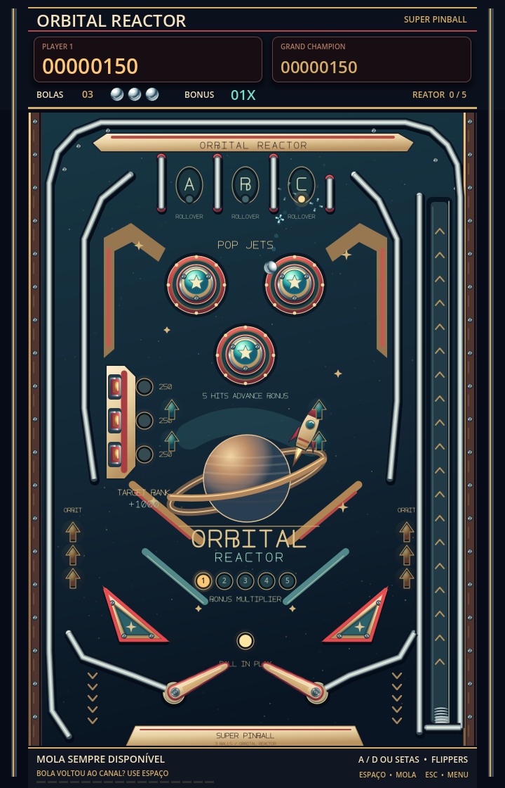

# Super Pinball — Orbital Reactor

Mesa vertical em Godot 4.7, na branch experimental `codex/pinball`, com arte vetorial original inspirada nos pinballs clássicos.

## Jogar

1. Abra `project.godot` no Godot 4.7 ou versão compatível.
2. Aguarde a importação dos recursos e pressione **F5**.
3. Escolha **INICIAR JOGO**. Segure **Espaço** para carregar a mola e solte para lançar.

A composição usa 720 × 1120, com janela inicial de 540 × 840. A mesa de 640 × 900 fica inteira na tela, com o placar acima e os controles abaixo.

| Controle | Ação |
| --- | --- |
| A / seta esquerda | Flipper esquerdo |
| D / seta direita | Flipper direito |
| Segurar e soltar Espaço | Carregar e liberar a mola |
| Esc | Retornar ao menu; fechar o manual |
| Mouse, setas, Tab e Enter | Navegar pelas telas |

**A mola continua disponível durante a partida.** Se a bola voltar ao canal, deixe-a chegar à base e use Espaço novamente. Também é possível segurar a tecla antes de ela chegar. O relançamento mantém a mesma bola, vidas, pontos e progresso.

## A mesa

Três pop bumpers, pistas A/B/C no topo, bancada lateral de alvos, órbitas nas laterais, duas borrachas triangulares e flippers articulados. Cada partida tem **três bolas**. Os canais abaixo das borrachas têm pelo menos 32,8 px livres para a esfera de 20 px.

| Evento | Pontos base |
| --- | ---: |
| Bumper | 100 |
| Pista A/B/C ainda apagada | 150 |
| Alvo lateral ainda apagado | 250 |
| Borracha triangular | 50 |
| Completar A/B/C | 750 de bônus e uma carga do reator |
| Acender os três alvos | 1.000 de bônus |
| Cinco cargas do reator | 500 de bônus e próximo multiplicador |

O multiplicador vai de **1x a 5x**. Pontuação, luzes e multiplicador permanecem entre bolas. As bancadas completas apagam após 1,4 segundo. A reposição após uma queda leva 1,2 segundo.

O recorde fica em `user://pinball_records.cfg`, separado do Arkanoid. O menu mantém os volumes independentes de música e efeitos e as faixas escolhidas pelo usuário.

## Arte e referências

Cromados, borrachas vermelhas, plásticos marfim e lâmpadas âmbar e turquesa acompanham a ilustração espacial original. A mesa usa SVGs e fonte suave, sem a limitação de 16 bits.

O material original de [Firepower, da Williams](https://flyers.arcade-museum.com/pinballs/show/6886), orientou a composição espacial e as peças; as [instruções de Eight Ball Deluxe, da Bally](https://www.pinballrebel.com/game/pins/instruction/Eight_Ball_Deluxe.pdf), serviram de referência para bancadas, pistas e bônus. As imagens desses jogos não fazem parte dos recursos do projeto.

## Estrutura

- `Scenes/Pinball/`: mesa e peças físicas reutilizáveis.
- `Scripts/Pinball/`: geometria, lançador, contatos e pontuação.
- `Scripts/UI/`: menu, manual, placar e Game Over.
- `Assets/Pinball/`: oito SVGs originais; os PNGs anteriores ficam como histórico.
- `Tools/generate_pinball_art.py`: gerador vetorial usando apenas Python padrão.
- `Tests/`: integração, canais inferiores e relançamentos.
- `Docs/PINBALL.md`: decisões de física e validação.

O Arkanoid permanece na branch `codex/redesign-16bit`.

## Recriar a arte e validar

```sh
python3 Tools/generate_pinball_art.py
godot --headless --path . --script Tests/pinball_test.gd
godot --headless --path . --script Tests/pinball_channels_test.gd
godot --headless --path . --script Tests/pinball_launcher_test.gd
godot --headless --path . --script Tests/quit_test.gd
```

Use o caminho completo do Godot se ele não estiver no PATH. Os testes de integração usam arquivos temporários separados para recorde e preferências.


